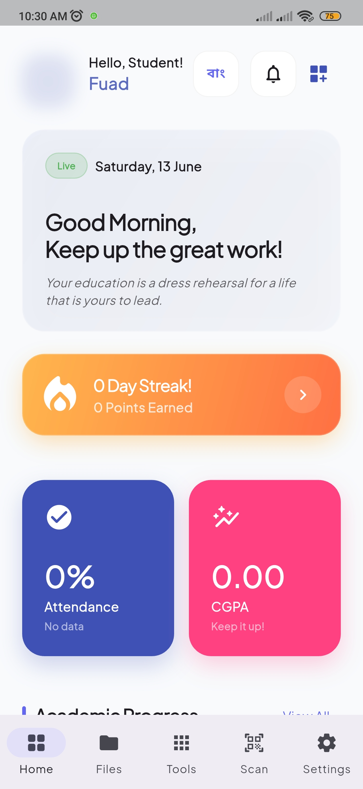
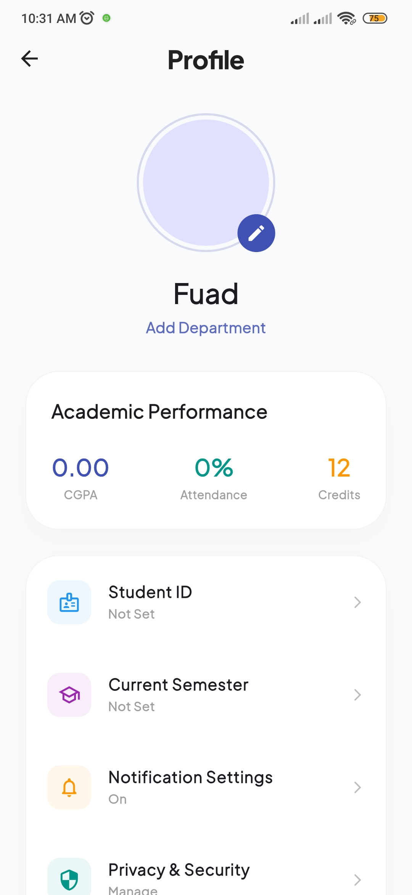
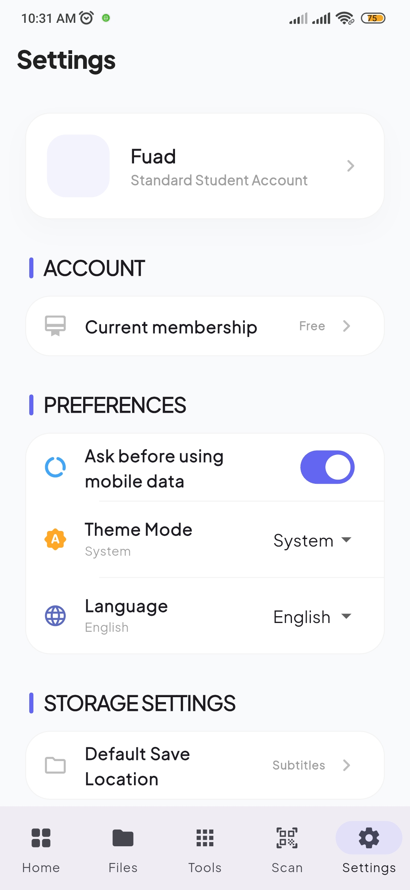
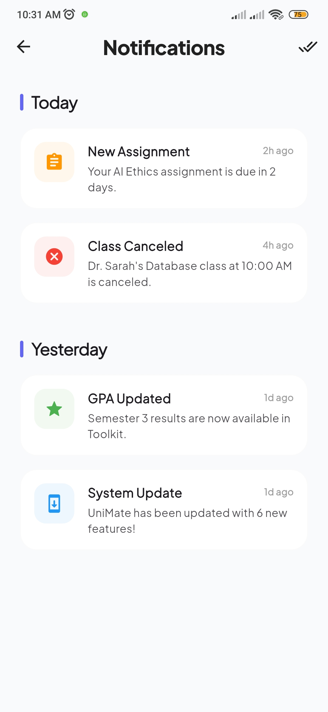
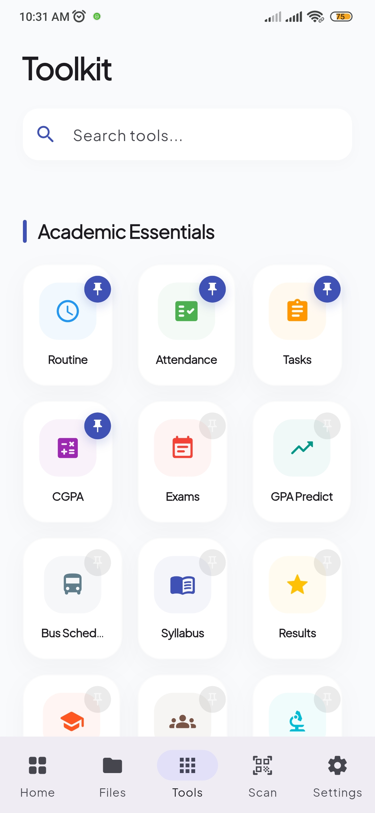
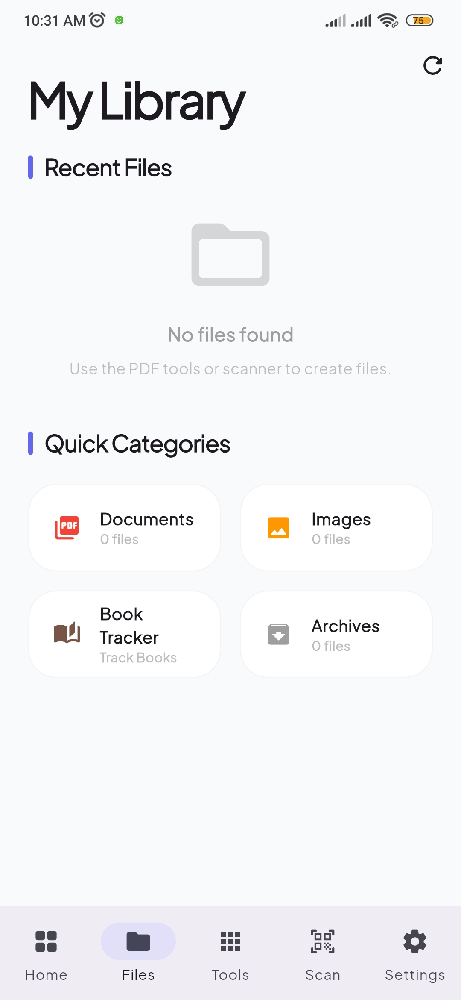
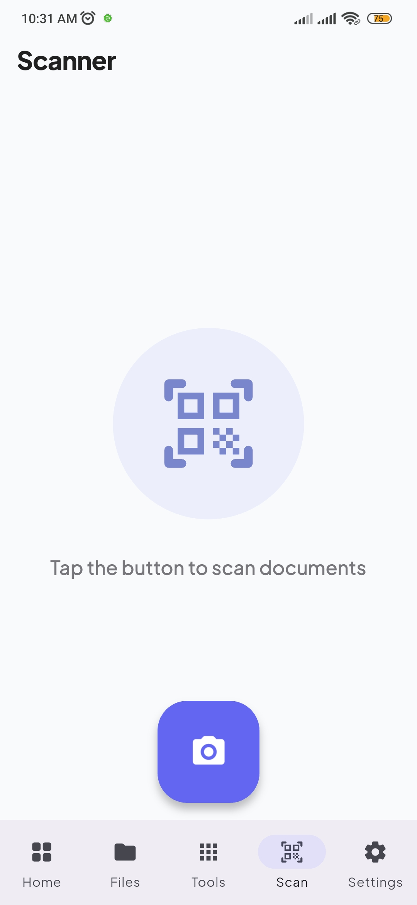
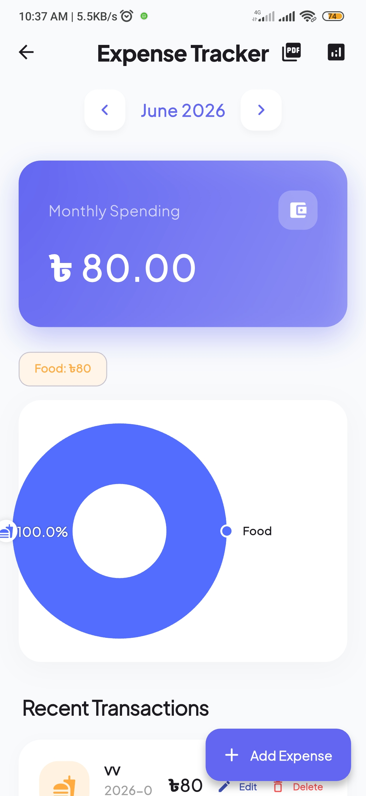

# 🎓 UniMate
### **Your All-in-One Smart University Companion**

**Designed to simplify student life, boost productivity, and keep everything academic in one intelligent ecosystem.**

---

[Explore Features](#-core-experience) • [Visual Showcase](#-app-interface-gallery) • [Architecture](#-architecture--technology) • [Tech Stack](#-tech-stack)

---

## 📖 Overview

**UniMate** is an all-inclusive student productivity platform engineered with Flutter, tailored for university students who require a streamlined, digital academic command center.

From routine management and attendance telemetry to automated CGPA forecasting, document OCR scanning, mess expense auditing, and conversational AI assistance powered by **Google Gemini**, UniMate consolidates scattered campus tasks into an effortless, unified workflow.

---

## 📸 App Interface Gallery

### 🔐 Onboarding & Core Navigation
*Seamless account setup and intuitive modular dashboard.*

  
  
  
  
   
  
  
  
  
   
  
  
  

---

## 🌟 Core Experience

### 🎯 Academic Essentials
*Predictable, automated academic progress tracking.*

- 📅 **Smart Routine Manager:** Visual class schedules with smart conflict detection.
- 📈 **Attendance Telemetry:** Real-time attendance percentage with minimum percentage shortage warnings.
- 📝 **Deadlines & Exam Countdown:** Visual calendar of upcoming quizzes, midterms, and finals.
- 🎓 **CGPA Forecasting Engine:** Dynamic GPA calculator with what-if scenario simulations.
- 🚌 **Campus Transport Schedules:** Instant bus route lookups and timing notifications.
- 👨‍🏫 **Faculty Directory:** Fast access to advisor emails, consultation hours, and department desks.
- 📚 **Library & Borrowing Vault:** Track borrowed literature and return due dates.

  
  
  
  
   
  
  
  
  
   
  
  
  
  
   
  
  

---

### 💼 Campus Life, Documents & Financial Audit
*Handling living expenses, shared mess meal logs, and document suites.*

- 💸 **Expense Intelligence Dashboard:** Category-level cashflow analysis for living expenses.
- 🍽️ **Mess Meal Management:** Shared cost distribution, meal counts, and monthly grocery splits.
- 🗒️ **Encrypted Notes Vault:** Markdown-ready lecture notes and quick-action memos.
- 🎙️ **Voice Dictation Notes:** Audio recording support for study discussions.
- 📆 **Academic Calendar Sync:** Institutional holidays and semester milestones.

  
  
  
  
   
  
  
  
  
   
  
  
  
  
   
  
  
  
  

---

### 🚀 Productivity Tools Suite
*High-focus utilities to elevate exam preparation.*

- ⏳ **Pomodoro Timer Engine:** Custom work-break intervals with streak rewards.
- ✅ **Habit Tracker:** Daily discipline builder for revision habits.
- 🧠 **Flashcard Spaced Repetition:** Active recall cards for formula memorization.
- 📄 **Document Scanner & OCR:** On-device camera scanning with ML text extraction.
- 🔲 **QR Code Utility:** Quick generator and reader for campus links.

  
  
  
  
   
  
  
  
  
   
  
  
  
  

---

### 🤖 Intelligent AI Academic Assistant
*Powered by Google Gemini Generative AI.*

- 💡 Complex concept explanations in plain terms.
- 📐 Step-by-step problem-solving breakdowns.
- 📋 Essay outline generation and study schedule advice.

  
  
  
  
   
  
  
  
  

---

### 🗄️ Database Architecture
*Normalized MySQL schema designed for high relational reliability.*

  
  

---

## 🛠️ Tech Stack

| Layer | Technology | Purpose |
| :--- | :--- | :--- |
| **Framework** | Flutter (SDK 3.x) | Modern Cross-Platform Client |
| **Language** | Dart | Strong-typed application logic |
| **State Management** | Riverpod | Reactive, compile-safe dependency tree |
| **Backend** | Node.js + Express.js | Scalable REST API endpoints |
| **Database** | MySQL & Drift (SQLite) | Persistent Cloud & Local Storage |
| **AI Engine** | Google Gemini Generative AI | Conversational Academic Tutor |
| **Vision & OCR** | Google ML Kit Text Recognition | Edge Document Scanning |
| **Visuals** | `fl_chart`, `lottie`, `flutter_animate` | High-fidelity interactive graphics |

---

## 📄 License
Distributed under the MIT License. See `LICENSE` for more information.

**Developed with ❤️ by Fuad**  
*Developed by Softece*  
*UniMate*

